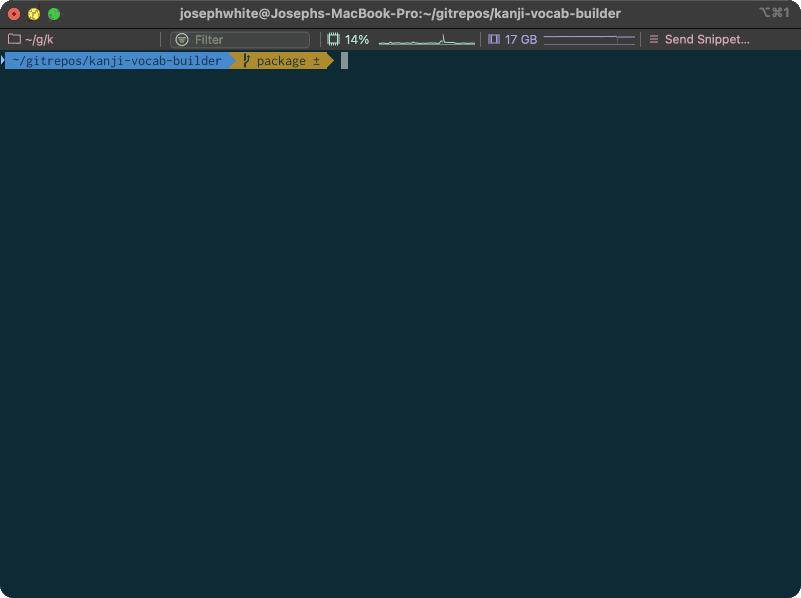

# Kanji Vocab Miner

This is a very simple CLI tool to help with learning Japanese kanji and vocabulary. It glues together Jisho (an online Japanese dictionary) and Anki (the flashcard program), and designed with a context-based learning approach to Kanji in mind; as new kanji are learned, we find new vocabulary that include those Kanji to learn the readings (rather that painful rote memorization of kun and on readings from kanji alone).



## What It Does

The tool allows for searching of either specific kanji or words.
- When a word is searched, it will look up the word on Jisho, display its details, and allow you to add it to your Anki vocabulary deck.
- When a kanji is searched, it will first look up the Kanji on Jisho, then fetch a list of vocabulary words that include that kanji, with details including JLPT level, whether the word already exists in your Anki deck and whether the other kanji in the word are already in your list of reviewed kanji. You can then select which words to add to your Anki vocabulary deck.

The workflow is designed to complement kanji study: as you learn new kanji, you naturally build vocabulary that reinforces those characters.

## Who is it for?
Originally just me!

There are literally hundreds of far more polished/sophisticated tools for learning Japanese available on the web. The use-case/workflow here is very niche to my own learning style and circumstances. You might find this tool useful if:
   - You are reading primarily printed Japanese texts (textbooks and novels) rather than online content, where vocabulary mining tools like Rikaichan, or learning apps like Todai are arguably far more useful/convenient.
   - You already have a decent base of spoken Japanese and are focusing on catching up on reading/writing skills (this may apply to learners who grew up speaking, but not reading/writing, Japanese).
   - You hate Duolingo and would actually like to learn a language properly!


## Installation

Using this tool requires some Anki setup:

1. **Anki Desktop** - Download from [apps.ankiweb.net](https://apps.ankiweb.net/)
2. **AnkiConnect Plugin** - Install from [AnkiWeb](https://ankiweb.net/shared/info/2055492159)
   - In Anki: Tools → Add-ons → Get Add-ons → Enter code `2055492159`. This plugin allows external programs to interact with Anki via a local API.
3. **"All in One Kanji" Deck** - Download from [AnkiWeb](https://ankiweb.net/shared/info/1862058740)
   - This is the recommended kanji deck that the tool expects by default.
   - File → Import → Browse to downloaded `.apkg` file
   - The tool will re-order existing cards from this deck for kanji study, while creating entirely

Once this is done (and Anki is running with AnkiConnect enabled), install the tool with [uv](https://docs.astral.sh/uv/):

```bash
uv tool install git+https://github.com/yourusername/kanji-vocab-miner.git
kanji-vocab-miner setup
```

This installs `kanji-vocab-miner` globally so you can run it from any directory. If you don't have uv installed, follow the [uv installation guide](https://docs.astral.sh/uv/getting-started/installation/).

To update to the latest version, upgrade the tool and run setup again so Anki has
the current V3 vocabulary note type and templates:

```bash
uv tool upgrade kanji-vocab-miner
kanji-vocab-miner setup
```

A [DeepSeek API key](https://platform.deepseek.com/) is required when committing
new vocabulary, but not for setup, searching, or reviewing pending words. Export
it in the environment used to launch the tool:

```bash
export KANJI_VOCAB_MINER_LLM__API_KEY="your-api-key"
```

The key is environment-only. **Do not put it in `config.toml`.**


## Usage

### Interactive Mode

Make sure Anki is running and run `kanji-vocab-miner` to start the interactive session:

**Commands:**
- `n` - Look up the kanji on the card currently open in Anki Reviewer
- `a` - Move the most recently looked-up kanji card to the top of its Anki deck
- `c` - Review and commit pending words to Anki
- `q` - Quit the program
- Type a kanji directly (e.g., `食`) - Search for words containing that kanji and show whether its Anki card has been reviewed
- Type `@word` (e.g., `@食べる`) - Look up a specific word on Jisho
- When in word selection mode, enter numbers or ranges (e.g., `1 3 5` or `1-5`) to select words to add

### Furigana article reader

The visual refresh and verification status are tracked in the
[frontend polish plan](docs/reader-frontend-plan.md).

Start the localhost-only web reader with Anki Desktop and AnkiConnect running:

```bash
kanji-vocab-miner web
# Open http://127.0.0.1:8766
```

Paste up to 50,000 characters of plain Japanese text. The limit is checked on
submission rather than silently truncating pasted text. The result colours
unknown words using the bundled, unofficial JLPT N5–N1 vocabulary data; a
**Highlight known words** toggle can extend those colours to known vocabulary.
You can show furigana for **unknown kanji only**, for every word, or for no words.
Furigana uses a separate known-kanji inventory, not vocabulary membership. A grouped
reading stays visible until all kanji represented by that group are known.
Runs of blank lines are reduced to one blank line between paragraphs. Below
the article, an unknown-vocabulary list groups dictionary forms from N5 through
N1, followed by unlisted words. Entries show their article frequency and are
sorted by descending frequency within each level; ties retain first-appearance
order. The responsive vocabulary grid shows each level's distinct-word count and
compact frequency badges. Highlighted words have subtle inline outlines, while
known words stay visually quiet until highlighting is enabled. The grouped furigana
controls and separate highlighting toggle work without reprocessing the article.
**Start Over** returns to an empty editor (or the sample text in the explicit demo).

A token is treated as known when its normalized dictionary identity matches an
`Expression` in the configured Anki vocabulary deck or an entry in
`~/.config/kanji-vocab-miner/known_vocab.txt`. The reader reloads both sources
on every submission, along with kanji from the configured kanji deck. The kanji
inventory uses the existing reviewed-card criterion (`-is:new OR flag:1`), not kanji
that merely occur in vocabulary cards. If either Anki inventory cannot be loaded,
the reader blocks the result rather than silently treating it as empty. Real Anki
verification of this new reader path remains pending; offline tests mock all IO.

The reader uses **Sudachi C-mode segmentation** with its core dictionary. Only
kanji-containing vocabulary receives JLPT backgrounds. The reader extends a verb
or adjective's background over common adjacent inflection endings, so `乗った`,
`食べました` and `降って` each have one continuous highlight. This is display-only:
Sudachi still supplies separate tokens such as `食べ / まし / た`; vocabulary
matching, counts and JLPT level come from the lexical token, not its endings.

The bounded display policy includes past/conditional `た`, polite `ます`/`です`,
negative `ない`/`ぬ`, passive/potential `れる`/`られる`, causative `せる`/`させる`,
desiderative `たい`, and connective `て`/`で`. Adjectival negatives such as
`難しくない` are also grouped. Grouping stops at whitespace, punctuation or other
words: `降ってきた` highlights `降って` but leaves the kana continuation neutral.
Noun copulas, standalone particles/auxiliaries and affixes remain separate;
`子供っぽい` still uses `子供 / っぽい`. This is not a general phrase or compound
joining engine and does not affect Anki cue rendering.

Dictionary-form matching handles inflections without marking unrelated kanji
homophones as known. JLPT vocabulary data is unofficial and incomplete; unlisted
words remain uncoloured, including their display-grouped endings.

Parser-tagged person and place names have **dotted underlines** rather than JLPT
backgrounds and are omitted from the unknown-vocabulary list. This is a small use of
Sudachi's existing tags, not comprehensive name recognition. Names and ambiguous
words can have incorrect or missing readings. The reader keeps original text and uses
grouped ruby when reliable kana alignment is unavailable.

#### Offline demo (no Anki needed)

```bash
uv sync
uv run python -m kanji_vocab_miner.web --demo
# Open http://127.0.0.1:8766 (use --port 8767 if needed)
```

The demo is clearly labelled and uses explicit mock inventories: known vocabulary
`学校`, `図書館`, `食べる`, `経済的`; known kanji `学校食見日人本大生`.
It does not read your known-vocabulary file or call Anki. This is never an automatic
fallback for a failed live connection.

Open [the standalone native preview](docs/reader-sudachi-preview.html) for all eight
reviewed passages, native boundaries/readings and comparisons with the original human
annotations. Regenerate it offline with:

```bash
uv run python scripts/preview_sudachi_reader.py
```

SudachiPy **0.6.11** and SudachiDict-core **20260428** are pinned together for binary
compatibility, avoiding the currently unstable 0.7 transition. The core dictionary
adds roughly 70 MB compressed to installation. Sudachi code/dictionary package licensing
is Apache-2.0 with additional incorporated-resource notices; retain those notices when
redistributing. See [SudachiDict LEGAL](https://github.com/WorksApplications/SudachiDict/blob/develop/LEGAL).
The reader and Anki Japanese-definition cues share one UI-independent Sudachi
C-mode tokenizer; Fugashi and UniDic-lite are no longer required.

To retain the 50,000-character input limit within Sudachi's byte limits, long articles
are chunked near sentence/newline boundaries. Extremely long unbroken text may be split
inside a word; normalization-expanded input is reduced into smaller chunks if needed.
No source characters are dropped. The same size handling applies to Japanese cues.

#### Anki cue tokenization migration

New Japanese-definition cues use the same pinned Sudachi engine/core dictionary.
They retain the original source text, including CR/LF, repeated blank lines and
leading/trailing whitespace: the reader's newline normalization is **not** applied
to stored definitions. Each sense still has its own escaped `<div class="sense">`
block, separated by `<br>`, and ruby visibility still uses Anki's `rt.known` class.
Reader JLPT metadata, vocabulary filters and name styling do not enter card HTML.

Native C-mode boundaries/readings can differ from the former Fugashi/UniDic-lite
output. Representative offline comparisons:

| Text | Former cue analysis | Sudachi cue analysis |
| --- | --- | --- |
| `国家公務員` | `国家 / 公務 / 員` | One ruby group, `こっかこうむいん` |
| `東京都` | `東京 / 都` | One ruby group, `とうきょうと` |
| `食べました` | `食べ / まし / た` | Same boundaries; okurigana remains outside ruby |
| `取り扱う`, `大人` | Kana-aligned / irregular grouped ruby | Same rendering structure |
| `今日` in the comparison phrase `取り扱う 大人 今日 一日` | `こんにち` | `きょう` |

Readings remain contextual, not guaranteed for ambiguous words or names. Missing
and out-of-vocabulary readings remain plain text; for example Sudachi tagged `一`
in that comparison phrase as OOV, so it receives no ruby. Larger ruby groups also
mean their reading stays visible until **all** represented kanji are known. No
custom joining, deinflection, name recognition or extra dictionary is applied.

This affects **future cue generation only**. Existing notes are not regenerated,
card templates are unchanged, and target-word front-card furigana still comes from
Jisho. Regenerating stored cue fields requires a separate explicit decision.

### Vocabulary cards and commit review

Run `kanji-vocab-miner setup` after installing or upgrading. Setup creates or
safely refreshes the required `MyJapaneseVocabularyV3` note type in the existing
`KanjiVocabMiner-Vocabulary` deck. It does not migrate or regenerate existing
cards. Legacy `MyJapaneseVocabulary` and `MyJapaneseVocabularyV2` notes remain
unchanged in the deck.

New pending words default to **Add on** and **Recall off**. The commit review
screen supports:

- `Up`/`Down`: move between rows
- `Space`: toggle Add for the focused row
- `r`: toggle Recall; enabling Recall also enables Add
- `a`/`n`: enable or disable Add for all rows without erasing Recall choices
- `Enter`: commit Add-enabled rows and discard Add-disabled rows
- `Esc`/`q`: abort while preserving pending rows and Recall choices

Each newly committed V3 note receives a Japanese-to-English recognition card.
Its back shows these sections in order:

1. the primary Jisho dictionary definition;
2. **Nuance** — one English sentence about usage beyond the short definition;
3. **Example** — one short Japanese sentence, with the exact used form bold and
   red (no translation or separate reading); and
4. **Why these kanji** — a word-level explanation of the kanji, okurigana, or
   the fact that no kanji applies.

DeepSeek generates the three enrichment sections automatically during commit.
Generation is grounded in the word's first dictionary definition and first part
of speech. There is no generated-content preview or approval step. The existing
recall card behavior is unchanged: enabling Recall also creates a
Japanese-definition-to-Japanese-word card.

The Japanese definition is fetched synchronously from Kotobank for every note,
including recognition-only notes. Definitions prefer デジタル大辞泉 and fall
back to 精選版 日本国語大辞典. Results are not cached. The normalized text,
rendered cue, source name, and canonical source URL are stored on the note.
DeepSeek generation runs concurrently, while successful notes are written to
Anki sequentially in the reviewed order. The CLI shows one **Pushing to Anki…**
activity spinner throughout the batch, then reports the added, already-existing,
and failed counts; it does not show percentages or changing phase labels.

Each word gets at most three DeepSeek attempts, with short exponential backoff
and validation feedback after an invalid response. If definition lookup, furigana
rendering, enrichment, note serialization, or Anki writing fails, that word is
skipped while other successful rows can still be committed. Failed rows remain pending in reviewed order with
their Recall choice for retry. If the API key is missing, all eligible
nonduplicate rows fail clearly at enrichment and remain pending; the tool never
falls back to creating V2 or unenriched V3 notes.

Legacy, V2, and V3 expressions all participate in duplicate detection. Legacy
and V2 notes remain in the deck and continue to participate in furigana sync
when they contain compatible `Front` or `JapaneseCue` fields.

Cue furigana follows the same reviewed-kanji visibility rules as the vocabulary
word. To enable recall later, set the note's `Recall` field to `1` in Anki. To
disable it, clear `Recall`, then run **Tools → Empty Cards** because Anki keeps
previously generated cards until empty cards are removed.

### DeepSeek enrichment settings

Setup creates the default editable prompt at
`~/.config/kanji-vocab-miner/enrichment-prompt.md` only when that file is
absent. Existing prompt edits are never overwritten. Edit this file to change
content guidance for nuance, examples, and kanji explanations. The application
owns the structured response schema, validation, and safe example highlighting;
the editable prompt does not replace that fixed contract.

The prompt path and request concurrency are the only LLM settings in
`~/.config/kanji-vocab-miner/config.toml`:

```toml
[llm]
prompt_path = "~/.config/kanji-vocab-miner/enrichment-prompt.md"
concurrency = 5
```

`concurrency` controls simultaneous DeepSeek generation requests, defaults to
`5`, and accepts values from `1` through `10`. The API key is not a TOML setting.
Set it in the process environment, or put the following in a `.env` file in the
current working directory (the repository `.gitignore` excludes this file):

```dotenv
KANJI_VOCAB_MINER_LLM__API_KEY="your-api-key"
```

An explicitly exported environment variable takes precedence over `.env`. When
running `uv run kanji-vocab-miner` from the repository root, the local `.env`
file is loaded automatically.

### Progress dashboard

Run `kanji-vocab-miner stats` to show your Kanji, Reading, Grammar, and
vocabulary progress. Overall bars appear together at the top, followed by
Kanji and textbook-part breakdowns. Vocabulary is measured against a core
6,000-word target: the tool adds every vocabulary note created on or after the
configured tracking date to the manually estimated baseline.

For now, the file is read from the directory where you run the command. When
working from this repository, edit the included `manual_progress.toml` and run
`uv run kanji-vocab-miner stats` from the repository root.

The file contains:

```toml
vocab_baseline = 4400
vocab_tracking_start = 2026-09-03

reading_i = 0
reading_i_total = 41
reading_ii = 0
reading_ii_total = 29
reading_iii = 0
reading_iii_total = 11
grammar_i = 0
grammar_i_total = 10
grammar_ii = 0
grammar_ii_total = 11
grammar_iii = 0
grammar_iii_total = 5
grammar_iv = 0
grammar_iv_total = 7
grammar_v = 0
grammar_v_total = 3
grammar_vi = 0
grammar_vi_total = 12
```

`vocab_baseline` is the known-word estimate on `vocab_tracking_start`.
Vocabulary notes added to the configured deck from that date onward increase
this count, whether or not they have been reviewed yet.

Each Reading and Grammar count is an independent number of completed sections.
Its matching `_total` value sets the bar's maximum; the overall maximum is the
sum of those section totals. The included file retains Reading totals of I=41,
II=29 (book sections 42–70), III=11, and Grammar totals of I=10, II=11 (book
sections 11–21), III=5 (book sections 22–26), IV=7, V=3, VI=12.
All nine `_total` keys are required.


## AnkiConnect troubleshooting

For the October 2026 API regressions, a manual new-card queue workaround, and a
reversible rollback checklist, see [the AnkiConnect recovery note](docs/anki-connect-rollback.md).

## Tests

```bash
uv sync
uv run pytest
```

The default suite uses mocked HTTP services and blocks accidental live Requests
calls. It needs neither a running Anki instance nor Jisho/DeepSeek access.
Dictionary tests use bundled local data or a miniature SQLite fixture.

Live Anki checks are opt-in: `uv run pytest -m integration`. Run them only against
a suitable test collection: some create/delete a test deck or temporarily change
an existing card's due value. They are not part of the default suite.

## Credits

- [Jisho.org](https://jisho.org/) for the excellent Japanese dictionary API
- [AnkiConnect](https://foosoft.net/projects/anki-connect/) for making Anki automation possible
- [All in One Kanji](https://ankiweb.net/shared/info/1862058740) deck creators (whoever you are!)
